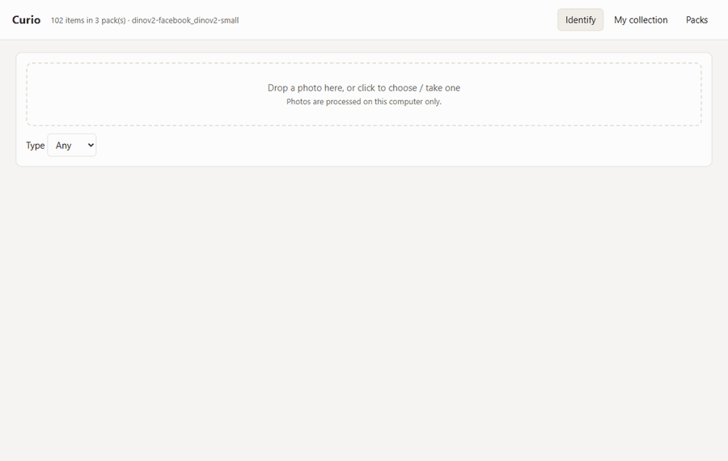
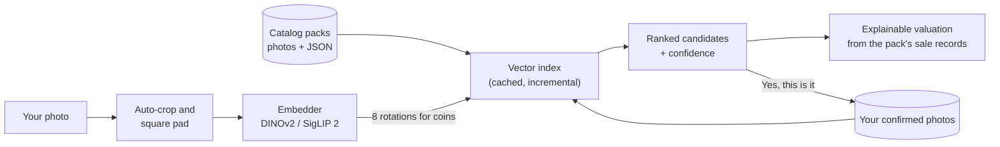
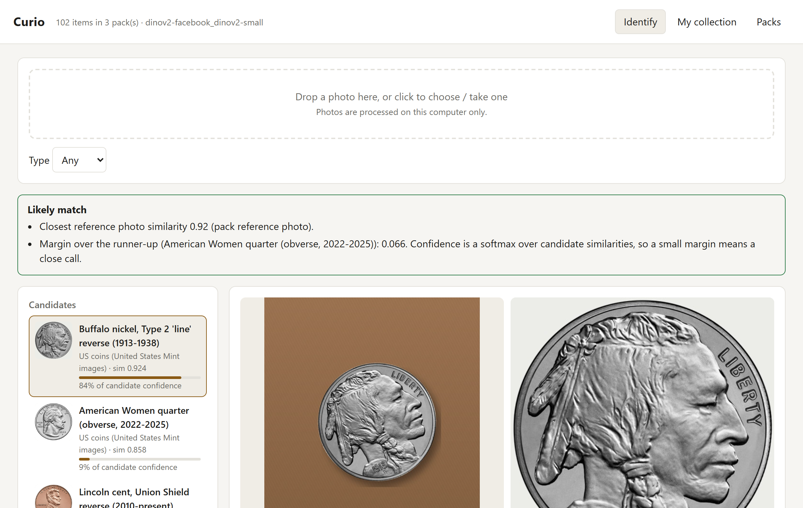
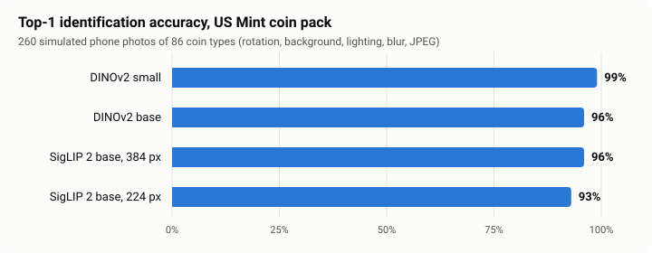
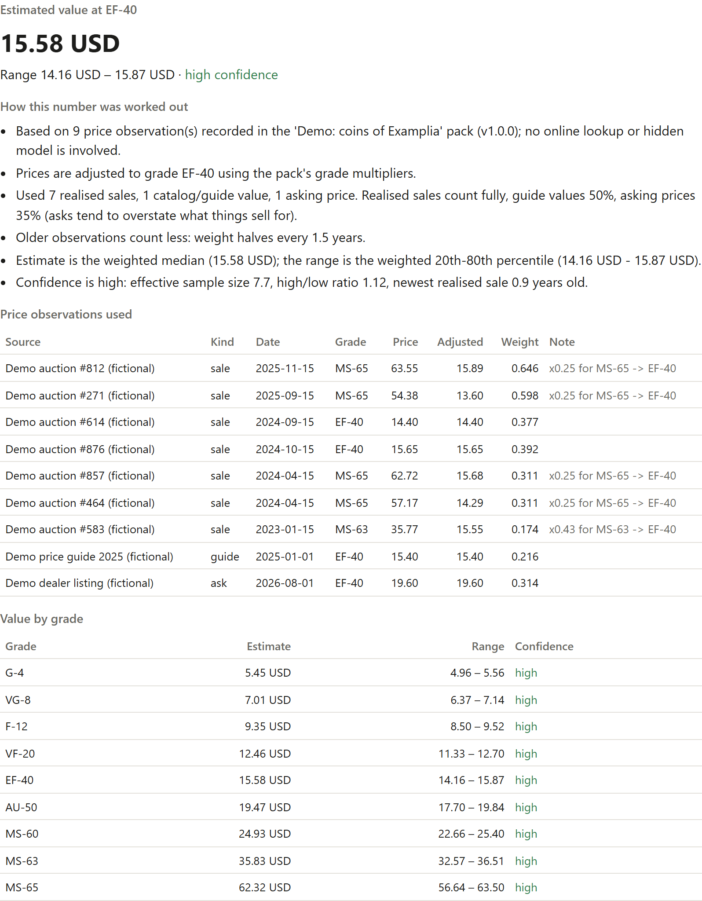
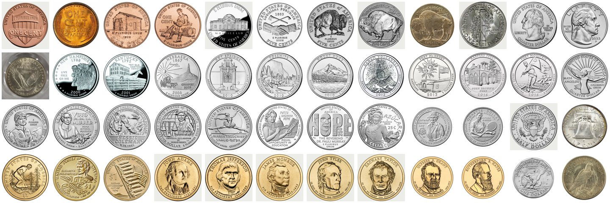

# Curio

A free, local, open-source identifier for coins, stamps and other collectibles: an alternative to subscription identifier apps.

- **Local.** Photos are processed on your own machine. There's no account, no subscription and no telemetry.
- **One engine for every hobby.** A general-purpose image embedder (SigLIP 2 or DINOv2) plus a vector index. Coins, stamps, cards and comics are just different **catalog packs**: plain folders of photos and JSON that the community maintains.
- **Explainable prices.** Every estimate shows its working: which recorded sales it used, how each one was adjusted for grade and age, how much weight it got, which ones it threw out and why, and how confident it is.

<p align="center">
  
  <br><sub>Identifying a coin from a photo, then the price working for a demo coin (demo pack prices are fictional). The photos are simulated from pack images.</sub>
</p>

## Quick start

```bash
pip install -e ".[ml,web]"          # torch + transformers + local web UI
python scripts/make_demo_packs.py packs
python scripts/build_us_mint_pack.py build   # real US coins from public-domain US Mint images
curio --packs packs serve           # open http://127.0.0.1:8765
```

On first use the model weights (~375 MB for SigLIP 2 base) download from Hugging Face. After that, everything runs offline.

On the command line:

```bash
curio --packs packs identify photo.jpg --grade VF-20
curio --packs packs search "red stamp with a sailing ship"   # text search (SigLIP only)
curio --packs packs value demo-coins:1-cent-1938 --grade VF-20   # full valuation working
curio --packs packs eval                                         # accuracy check per pack
```

If you don't have PyTorch, `--embedder simple` uses a dependency-free descriptor. It's fine for trying the app but too weak for real photos.

## How identification works



1. **Preprocessing.** The photo is auto-cropped to the object (it trims a uniform background) and padded to a square.
2. **Embedding.** The image becomes a normalized vector:
   - `siglip` (`google/siglip2-base-patch16-224`; used when no pack recommends otherwise) works well generally and also supports text search.
   - `dinov2` (`facebook/dinov2-small`) uses its CLS token plus mean patch features, which helps with fine visual detail.
   - Any SigLIP or DINOv2 checkpoint can be used with `--model`.
3. **Search.** Exact cosine search runs against every reference photo in the installed packs. Results are scored per item using that item's best-matching photo. For packs marked `rotation_invariant` (coins), the query is also embedded at 8 rotations, so it doesn't matter how the coin sits in the photo.
   Unless you choose an embedder, Curio uses the one the installed packs recommend (see [Catalog packs](#catalog-packs)).
4. **Verdict.**
   - `match`: one candidate clearly wins.
   - `ambiguous`: the top candidates are close, and the UI asks you to compare reference photos.
   - `no_match`: the best similarity falls below the embedder's threshold.
   
   Confidence is a softmax over candidate similarities, and the UI shows the raw similarity and the margin over the runner-up.
5. **Learning from you.** "Yes, this is it" saves your photo locally as an extra reference for that item, so similar photos match better next time. The index updates incrementally, so only new images are embedded.

Indexes are cached in `$CURIO_HOME/index/<pack>/<embedder>/` (default `~/.curio`). They rebuild automatically when a pack changes.

<p align="center">
  
</p>

### Measured accuracy (simulated phone photos)

<p align="center">
  <picture>
    <source media="(prefers-color-scheme: dark)" srcset="docs/images/accuracy-dark.svg">
    
  </picture>
</p>

The demo packs:

`curio eval` makes "phone photos" of each reference image by applying random rotation, framing, background, lighting, blur and JPEG compression, then checks whether identification still works:

| Embedder | Coins top‑1 / top‑3 | Stamps top‑1 / top‑3 |
|---|---|---|
| SigLIP 2 base | 85% / 100% | 100% / 100% |
| DINOv2 small | 65% / 98% | 100% / 100% |
| simple (no ML) | 43% / 77% | 72% / 94% |

On the real `us-mint-coins` pack (86 coin types, 260 simulated photos), DINOv2 small reached 99% top‑1 and SigLIP 2 base 93%. That pack recommends DINOv2, so Curio uses it automatically. On the demo packs, every SigLIP miss was between two coins whose designs differ only by the date. That is the hardest real-world case too: die varieties, mint marks and dates. Treat these numbers as a smoke test. Real-world accuracy depends on the pack having several good reference photos per item, and should be measured on held-out real photos.

## How valuation works

Implemented in `curio/valuation.py`. Every step appears in the UI and the CLI:

1. Use only price observations in the pack's currency. Nothing is converted offline without telling you.
2. **Grade-adjust** each price to your chosen grade using the pack's grade multipliers (for example an MS‑65 sale × 0.25 gives an EF‑40 equivalent).
3. **Weight** each observation:
   - by kind: realized sale 1.0, guide value 0.5, asking price 0.35 (asking prices overstate);
   - by age: the weight halves every 1.5 years;
   - and down-weight observations whose grade couldn't be adjusted.
4. **Drop outliers** that sit more than 3 robust standard deviations from the weighted median, measured on log price with a ~10% floor. Typical cases are mis-described lots and fantasy listings.
5. **Estimate** = the weighted median. **Range** = the weighted 20th–80th percentile.
6. **Confidence** (high / medium / low / none) depends on effective sample size, how wide the range is, and how old the newest realized sale is. If an item has no price data, Curio gives no estimate rather than inventing one.

<p align="center">
  
  <br><sub>The valuation panel for a demo coin. The demo pack's prices are fictional.</sub>
</p>

## Catalog packs

**Included:** `us-mint-coins`, which covers 86 US coin types with 130 public-domain images from the United States Mint and the Smithsonian. It is built by a rerunnable script that checks the license of every image; see [catalogs/README.md](catalogs/README.md). There are also two small fictional demo packs.

<p align="center"></p>

A pack is a directory that's easy to review in a pull request:

```
my-pack/
  pack.json
  items.jsonl     # one JSON object per line
  images/
```

`pack.json`:
```json
{
  "id": "us-lincoln-cents", "name": "US Lincoln cents", "domain": "coin",
  "version": "0.1.0", "license": "CC-BY-SA-4.0", "currency": "USD",
  "rotation_invariant": true,
  "recommended_embedder": {"name": "dinov2", "model": "facebook/dinov2-small"},
  "grades": {"order": ["G-4", "F-12", "VF-20", "EF-40", "MS-63"],
             "multipliers": {"G-4": 0.35, "F-12": 0.6, "VF-20": 0.8, "EF-40": 1.0, "MS-63": 2.3}}
}
```

An `items.jsonl` line:
```json
{"id": "1909-s-vdb", "title": "1909-S VDB Lincoln cent",
 "attributes": {"year": 1909, "mint": "S", "variety": "VDB"},
 "images": [{"path": "images/1909-s-vdb-obv.jpg", "side": "obverse", "license": "CC0-1.0", "source": "..."}],
 "prices": [{"value": 1150, "grade": "VF-20", "date": "2026-03-14", "kind": "sale",
             "source": "Auction house, lot 123", "url": "https://..."}]}
```

`recommended_embedder` is optional. It can be a name (`"dinov2"`) or a name plus a Hugging Face model id. Pick whichever scores best on `curio eval` for your pack. How Curio uses it:

- **`--embedder auto`** (the default) uses the packs' recommendation. If installed packs disagree, Curio uses the one most packs recommend; if none recommend one, it uses SigLIP 2.
- **An explicit `--embedder`** is always used. Curio warns about any pack that recommends something else, in the terminal and as a banner in the web UI.

Price `kind` is `sale` (realized), `guide` (catalog value) or `ask` (listing). Packs ship photos and metadata, never model vectors, so any embedder can index them.

### Contributor tools

```bash
curio new-pack packs/my-stamps --id my-stamps --name "My stamps" --domain stamp
curio add-item packs/my-stamps --id gb-1840-1d --title "1840 Penny Black" --image front.jpg --attr country=GB year=1840
curio add-price packs/my-stamps gb-1840-1d --value 450 --grade "Very Fine" --date 2026-05-01 --source "Auction lot 77"
curio validate packs/my-stamps
curio --packs packs/my-stamps eval
curio install packs/my-stamps         # copy into ~/.curio/packs
```

Good packs have:
- several photos per item (both sides, different lighting, real phone shots alongside catalog scans);
- photos that are licensed for redistribution, such as public-domain government mint images, museum open-access collections and CC‑licensed Wikimedia Commons photos;
- price observations that each cite a source, so every estimate can be checked.

## Project layout

| Path | Role |
|---|---|
| `curio/pack.py` | pack format, loading, validation |
| `curio/embed.py` | SigLIP / DINOv2 / simple embedders, auto-crop |
| `curio/index.py` | cached incremental vector index, learned-photo store |
| `curio/engine.py` | identification, verdicts, text search, confirmations |
| `curio/valuation.py` | explainable price estimates |
| `curio/evaluate.py` | simulated-photo accuracy check |
| `curio/server.py`, `curio/static/` | local web UI and collection (SQLite) |
| `curio/cli.py` | command line |
| `scripts/make_demo_packs.py` | fictional demo packs (procedural images, invented prices) |
| `scripts/build_us_mint_pack.py`, `catalogs/` | rerunnable builder for the real US coin pack, with its reviewable source list |
| `docs/make_readme_assets.py`, `docs/capture_screens.py` | regenerate the README chart, montage, screenshots and GIF |

Tests: `pip install -e ".[dev,web]" && pytest`

## Limitations and next steps

- **The first real pack, `us-mint-coins`, has no price data yet.** It covers 86 US coin types. It identifies coins but cannot value them until sourced sale records are added; see [catalogs/README.md](catalogs/README.md). World coins and classic stamps from museum open-access collections are good next packs.
- Dates and mint marks are small details that global embeddings blur. A planned improvement is a second re-ranking stage that compares the top candidates with local feature matching or OCR on the date and mint-mark region.
- Grading isn't automatic. You choose the grade, and the UI shows the value at every grade.
- Prices are only as fresh as the pack. A pack-update command (`curio pull`) and signed pack releases would help.

License: [Apache-2.0](LICENSE) for the code. Each pack declares its own data license; the `us-mint-coins` images are public domain.
